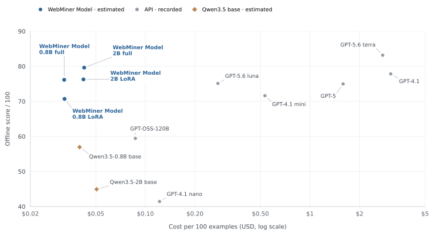

# WebMiner

The [WebMiner technical report](index.html) presents our approach to extracting structured business data from HTML and Markdown, covering the progression from direct SFT to stepwise supervision and five-task mixed training, along with model evaluation results.

## Score and generation cost

The horizontal axis shows cost per 100 examples (USD, log scale); the vertical axis shows offline scores. API costs are recorded charges, and local model costs are estimates for the generation stage.
